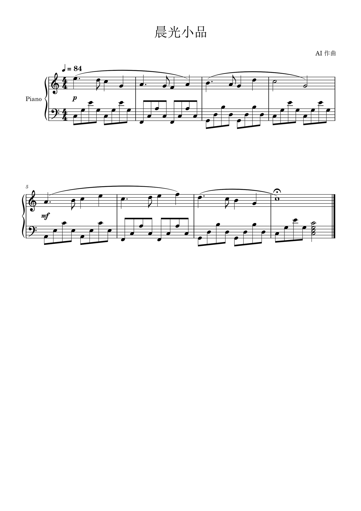
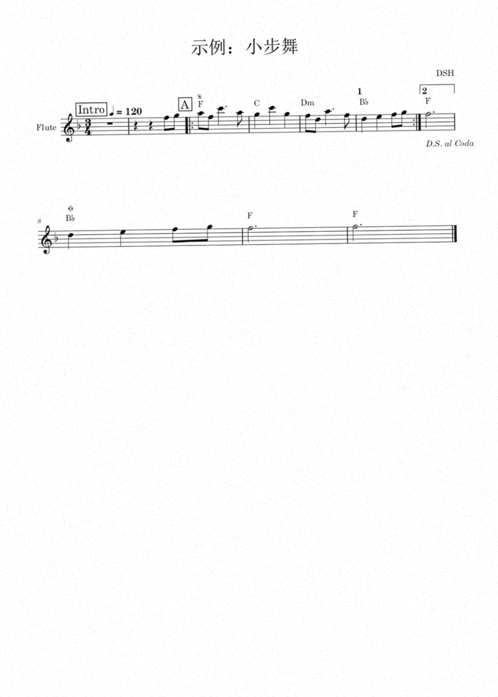
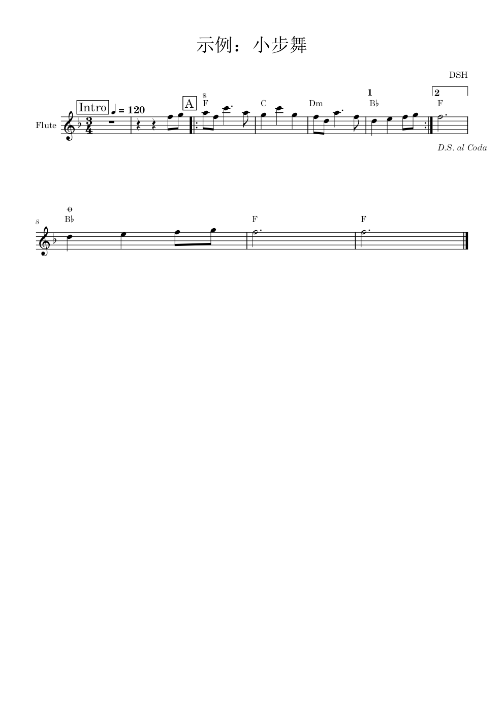

<div align="center">

# 🎼 MuseScore Skills for DeepSeek Harness

**让 AI Agent 写谱、排版、识谱——不要 GUI、不装插件、不联网。**

[](LICENSE)
[](https://www.python.org)
[](https://musescore.org)
[](#兼容性)
[](#路线图)

[English](README.md) · [简体中文](README.zh-CN.md)

</div>

---

两个给 **DeepSeek Harness** 用的 Agent Skill（技能），把 [MuseScore Studio 4](https://musescore.org) 接到命令行上。模型写 **MusicXML**，MuseScore 无头排版，你拿到的是真正可编辑的谱子——`.mscz`、PDF、PNG、MIDI 或 MP3。

这不是「AI 画乐谱图片」，而是一条确定性的记谱流水线：**音乐内容归模型，排版归 MuseScore**。

## 效果



*小提琴 + 钢琴，12 小节，由 `musescore-score` 从生成 MusicXML 到导出 `.mscz`/PDF/PNG/MP3/MIDI 全流程完成。想看她实际遵循的流程，见 [SKILL.md](skills/musescore-score/SKILL.md)。*

## 两个技能

| 技能 | 干什么 | 额外依赖 |
|---|---|---|
| [`musescore-score`](skills/musescore-score/SKILL.md) | **写谱**：用 MusicXML 描述旋律、和弦、双谱表、歌词、延音线/圆滑线、反复、力度、速度、换行，导出 `.mscz`/PDF/PNG/MP3/MIDI；也能转调（生成阶段）、抽分谱、校验元数据。 | MuseScore 4、Python 3.10+ |
| [`scan-score-to-musescore`](skills/scan-score-to-musescore/SKILL.md) | **识谱（半自动）**：扫描件/位图 PDF → 拟合五线谱与小节 → 符头定位换算音高 → 人看图核对节奏 → MusicXML → 排版成谱。单声部旋律、lead sheet 效果最好。 | 再加 numpy、Pillow、poppler |

两者互补：`scan-score-to-musescore` 只负责「图 → MusicXML」，排版和导出复用 `musescore-score` 的 `scripts/mscore.py`。

> **识谱那半另有独立仓库：** [HugoOu/scan-score-to-musescore](https://github.com/HugoOu/scan-score-to-musescore)。几何拟合的长文教程、《欢乐颂》公有领域示例、`--annotate` 调试图都在那边——想读原理去那边，想一次装齐就在本合集。工具是同一套；区别只在打包方式：本合集的 `mxml_ext.py` 直接复用 `musescore-score` 的 `mxml.py`，独立仓库自带一份。

## 工作方式

```
        ┌─────────────────────────┐
 扫描 → │ scan-score-to-musescore │ → score.json → MusicXML ─┐
        └─────────────────────────┘                           │
                                                              ▼
        ┌──────────────────────────────────────────────────────────┐
        │  mscore.py  ──▶  MuseScore 4 CLI（无头）                  │
        │                 └─▶ .mscz · PDF · PNG · MP3 · MIDI       │
        └──────────────────────────────────────────────────────────┘
                                                              ▲
        ┌─────────────────────────┐                           │
 灵感 → │    musescore-score      │ → MusicXML ───────────────┘
        └─────────────────────────┘
```

识谱只做一半的活——流水线**每次都会渲染 PNG 并真的看一眼**才敢说完成，因为 MuseScore 遇到不合法 MusicXML 不会报错，只会静默丢内容。




*左：识谱流程用的合成「扫描件」；右：排版后可编辑的成品。（示例由仓库自造的 `example_score.json` 生成，不包含任何第三方乐谱。）*

## 快速开始

```powershell
git clone https://github.com/HugoOu/dsh-musescore-skills.git
Copy-Item .\dsh-musescore-skills\skills\* "$env:USERPROFILE\.dsh\skills\" -Recurse
```

`DSH_HOME` 不是 `~/.dsh` 就拷到 `$env:DSH_HOME\skills\`。技能是纯文本 + Python 脚本，`musescore-score` 不需要 `pip install` 任何东西。

25 秒验证工具链：

```powershell
python "$env:USERPROFILE\.dsh\skills\musescore-score\scripts\selfcheck.py" --out .\ms-selfcheck
# 12/12 PASS —— 检测到 MuseScore 4.7.5，MusicXML → mscz/pdf/png/mid/mp3 全部有效
```

## 用法

### 写一首

直接说人话就行（技能的 description 就是路由信号）：

> 帮我写一首 8 小节的钢琴小曲，C 大调，右手旋律左手分解和弦，导出 PDF 和 mp3

也可以直接用构建库编程：

```python
import sys; sys.path.insert(0, r"~/.dsh/skills/musescore-score/scripts")
from mxml import Score

s = Score(title="晨雾", composer="你", key=1, time=(3, 4), tempo=66)
s.group_parts("bracket")                  # 多声部必须归组
vln = s.add_part("Violin", program=41)
pno = s.add_part("Piano", program=1, staves=2)

m = vln.add_measure()
notes = m.line("D5:2 B4:1")               # 音名:时值（四分音符倍数）
notes[0].slur = "start"
pno.add_measure().line("G2:1 D3:1 B3:1", staff=2, voice=2)

s.write("morning-mist.musicxml")
```

```powershell
python scripts/mscore.py convert morning-mist.musicxml morning-mist.mscz
python scripts/mscore.py convert morning-mist.mscz morning-mist.pdf
python scripts/mscore.py render morning-mist.mscz --dpi 150     # 生成 morning-mist-1.png
python scripts/mscore.py meta morning-mist.mscz                 # 回读确认内容真的进去了
```

### 识一份谱

```powershell
python scripts/pdf_scan.py score.pdf pages/                 # 抽页 + 找谱表行
python scripts/pitchmap.py pages --clef treble --key -1     # 符头候选
python scripts/probe.py pages/page-1.png 240 820 420 950 --ascii   # 核对线音/间音
python scripts/score_from_json.py score.json score.musicxml # 人工核对后的 JSON → XML
python scripts/verify.py score.musicxml out --pdf --dpi 130 # 排版 + 出图 + 元数据体检
```

识谱技能是**刻意做成半自动**的：几何交给脚本，节奏和句法靠看图确认。遇到太差的扫描件，它会直接告诉你「这份图不适合自动识谱」，而不是瞎猜一版给你。

### 两个技能怎么配合

分界点就是 MusicXML，交接物是一个文件：

| 你的起点 | 走法 |
|---|---|
| 一个想法 / 一段文字描述 | `musescore-score` → MusicXML → `mscore.py convert` / `render` |
| 扫描件或位图 PDF | `scan-score-to-musescore` → `score.json` → MusicXML → `verify.py`（内部调 `mscore.py`） |
| 人工核对好的 `score.json` | `score_from_json.py` → `mscore.py` |
| 已有的 `.musicxml` | `mscore.py convert` / `render` / `meta` |

上面的快速开始会一次装好两个技能，所以不用额外接线：识谱技能会去旁边的 `musescore-score` 找 `mxml.py` 和 `mscore.py`。只装识谱技能的话，请把 `musescore-score` 放在同一层——它的导入路径默认是 `~/.dsh/skills/musescore-score/scripts`（`verify.py` 可用 `--mscore` 覆盖）。

## 仓库结构

```
dsh-musescore-skills/
├── README.md                     ← English
├── README.zh-CN.md               ← 你在这里
├── LICENSE                       ← MIT
├── docs/
│   ├── legal.md                  ← 版权 / 商标 / 依赖许可
│   └── images/                   ← 效果图
└── skills/
    ├── musescore-score/
    │   ├── SKILL.md              ← 流程、验收标准、踩坑清单
    │   ├── scripts/  mxml.py · mscore.py · selfcheck.py
    │   ├── references/  MusicXML 速查 · CLI 速查 · 记谱配方
    │   └── assets/examples/  twinkle.py · satb.py
    └── scan-score-to-musescore/
        ├── SKILL.md
        ├── scripts/  pdf_scan · pitchmap · probe · score_from_json · verify · mxml_ext
        └── references/notation-mapping.md · assets/example_score.json
```

## 配置

| 变量 | 默认 | 用途 |
|---|---|---|
| `MSCORE_PATH` | 自动探测 | MuseScore 装在非标准路径时指向 `MuseScore4.exe` / `mscore` |
| `DSH_HOME` | `~/.dsh` | DSH 查找 `skills/` 的根目录 |

全程本地运行，无 API Key、无遥测、不联网。

## 兼容性

| 组件 | 实测 | 说明 |
|---|---|---|
| MuseScore Studio | **4.7.5**（Windows 11） | 用到的 CLI（`-o`、`-r`、`--score-meta`、`--page`）在 4.x 稳定；4.0–4.3 可能有差异 |
| Python | 3.12 / 3.14 | `musescore-score` 只用标准库 |
| 操作系统 | Windows 11 | `mscore.py` 里有 macOS/Linux 的探测路径，但**未实测** |
| poppler | TeX Live 自带 | 只有识谱技能需要 |

## 排错

| 现象 | 处理 |
|---|---|
| stderr 出现 `failed open log file …LocalLow` | 无害：MuseScore 写不了日志，导出照常成功 |
| 导入后整行谱表空白 | 和弦被写成一个 `<note>` 多个 `<pitch>`；必须是多个 `<note>`，第 2 个起带 `<chord/>` |
| 多声部不连括号、小节线不对齐 | `<part-list>` 缺 `<part-group>`（API 是 `Score.group_parts()`） |
| 找不到 `out.png` | MuseScore 图片导出实际叫 `out-1.png`、`out-2.png`… |
| 和弦糊成一团黑块 | 低 DPI 下相邻三度的渲染假象，先按 300 dpi 重渲染再判断 |
| 命令行启动插件失败 | MuseScore 4 已移除 `-p`；实时 GUI 编辑不在本技能范围内 |

更多见 [`references/musescore-cli.md`](skills/musescore-score/references/musescore-cli.md) 与 [`references/musicxml-cheatsheet.md`](skills/musescore-score/references/musicxml-cheatsheet.md)。

## 为什么做成技能，而不是一段提示词

同一道题（8 小节钢琴曲 + 导出 PDF/MP3）实测：**有技能 6 分 11 秒，无技能 12 分 30 秒**，且无技能那版得先手写 7.7 KB 的 MusicXML 生成器。路由验证做过 20 题 × 3 轮的触发评测，以及真实会话里的正例/负例。

技能里固化的是真会翻车的东西：静默丢内容、和弦编码、`<backup>` 时值、`part-group`、低分辨率误判——这些不是每次都能重新推出来的。

## 版权与合规

本仓库**只包含工具**——不含任何第三方乐谱、扫描件或音频。示例都是自造素材或公有领域旋律（如《小星星》）。

处理别人的作品时**责任在使用者**：转录、改编、分发受版权保护的音乐需要权利人许可，"个人学习"不覆盖公开发布。本工具不破解 DRM、不抓取曲库/流媒体站点。MuseScore 是独立的 GPL-3.0 程序，本项目只调用其命令行，**与 Muse Group 无隶属关系**。

完整分析见 [docs/legal.md](docs/legal.md)。

## 参与

欢迎 issue 与 PR，尤其是：MuseScore 4.x 各版本差异、macOS/Linux 实测、密集和弦/多声部总谱的识谱改进。示例素材请保持自造或公有领域。

## 许可

[MIT](LICENSE) © 2026 Yuhao Ou

## 致谢

- [MuseScore Studio](https://musescore.org) —— 排版引擎与 CLI
- [MusicXML](https://www.w3.org/community/musicxml/) —— 让这一切可行的交换格式
- [DeepSeek Harness](https://github.com/deepseek-ai) —— 这些技能挂靠的 Agent 运行时
